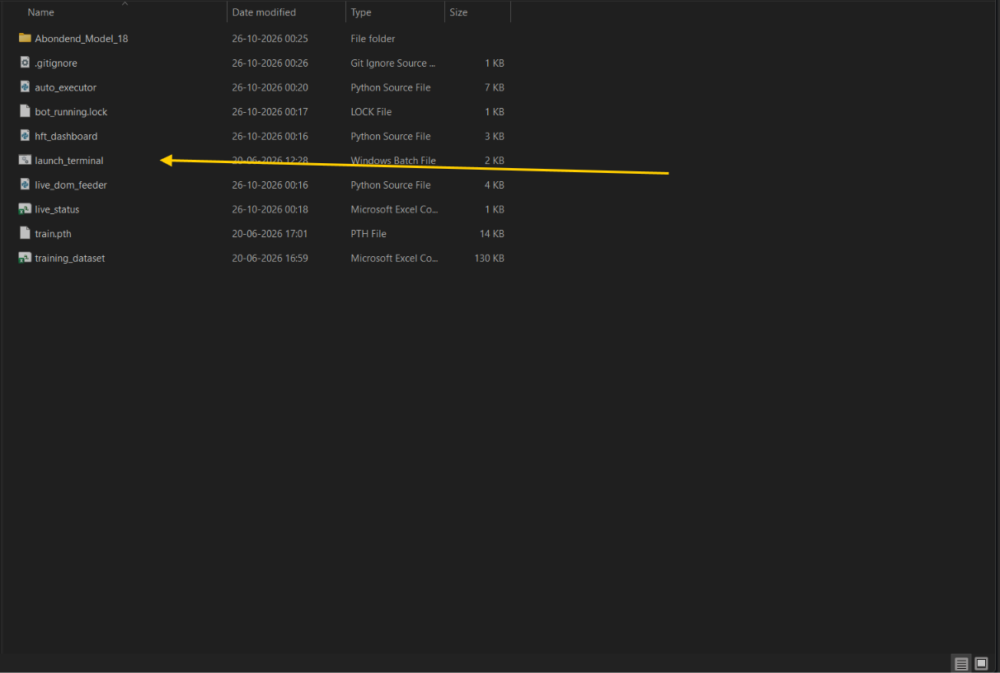
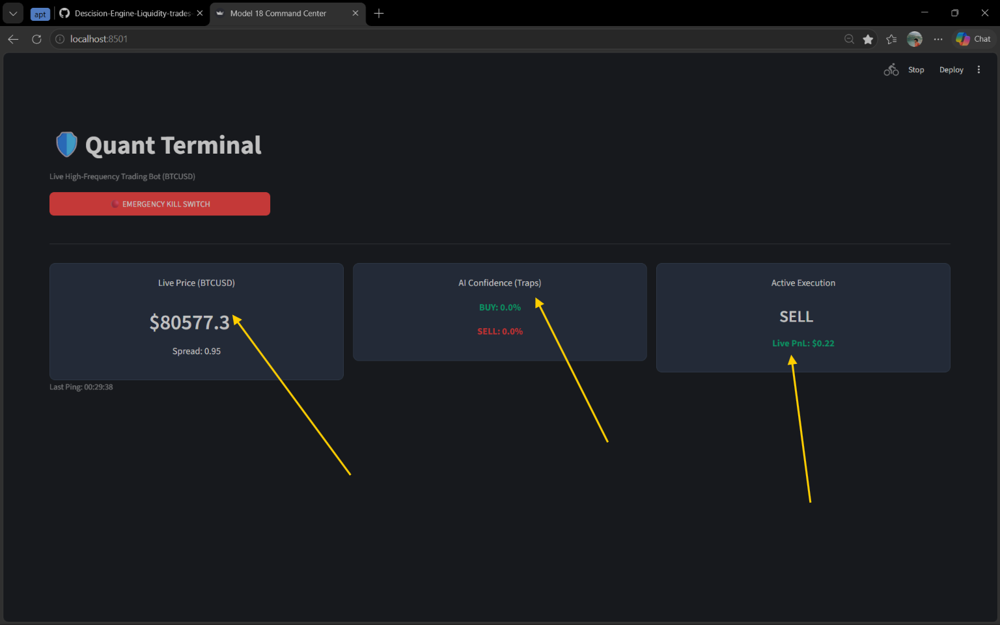
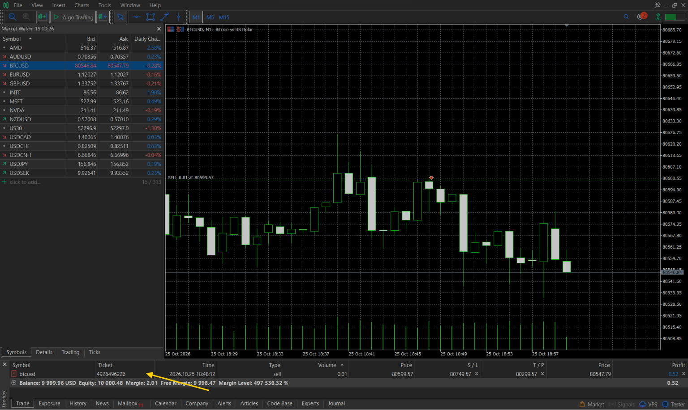

# Quant Trading Terminal (BTCUSD)

A Python-based BTCUSD automated trading prototype connected to MetaTrader 5 (MT5) that evaluates live tick features with a PyTorch neural network to execute trades and stream real-time telemetry to a Streamlit dashboard.

---

## Screenshots / Demo


*One-click batch launcher (`launch_terminal.bat`) inside the project directory.*


*Live Streamlit dashboard displaying BTCUSD price, spread, BUY/SELL confidence, active status, live PnL, and the emergency kill switch.*


*MetaTrader 5 terminal showing live position execution, entry price, stop-loss, and take-profit levels.*

---

## Key Features

* **Live MT5 Tick Pipeline:** Streams real-time `BTCUSD` tick data (`Bid`, `Ask`, `Spread`, `Velocity_ms`) directly from MetaTrader 5.
* **High-Frequency Feature Engineering:** Computes rolling 50-tick metrics including `Mid_Price`, `Price_Change`, `Tick_Imbalance`, `Velocity_Z`, and `Spread_Z`.
* **PyTorch Neural Classifier:** Evaluates 5 engineered tick features through a multi-layer neural network (64 and 32 hidden units) to classify market action into `HOLD`, `BUY`, or `SELL`.
* **Automated Order Execution:** Submits market orders (`0.01` lot with configurable SL/TP distances) to MT5 when model confidence crosses the **85%** threshold.
* **Real-Time Dashboard & Kill Switch:** Monitors live execution metrics via Streamlit and provides an emergency stop button (`kill_switch.txt`) to halt the executor immediately.

---

## Tech Stack

* **Language & Environment:** Python 3.10 / 3.11 (Windows)
* **Broker & Market Execution:** MetaTrader 5 Desktop Terminal, `MetaTrader5` Python API
* **Machine Learning:** PyTorch (`torch`)
* **Data Processing:** Pandas, NumPy
* **Frontend UI:** Streamlit

---

## Installation & Quick Start

1. **Clone the repository and navigate to the project folder:**
   ```powershell
   git clone <your-repository-url>
   cd Model_18
   ```

2. **Create a virtual environment and install dependencies:**
   ```powershell
   py -m venv .venv
   .\.venv\Scripts\Activate.ps1
   python -m pip install --upgrade pip
   pip install MetaTrader5 torch numpy pandas streamlit
   ```

3. **Launch the terminal:**
   * Open **MetaTrader 5**, log into a demo account, and ensure `BTCUSD` is visible in Market Watch.
   * Confirm `train.pth` is present in the root `Model_18/` folder.
   * Run the launcher:
     ```powershell
     .\launch_terminal.bat
     ```
     *(Alternatively, double-click `launch_terminal.bat` in Windows Explorer to start both the executor backend and Streamlit dashboard.)*

---

## Usage

* **Inputs:** 
  * Live `BTCUSD` tick stream from MetaTrader 5 (`Price_Change`, `Velocity_Z`, `Spread_Z`, `Spread`, `Tick_Imbalance`)
  * Trained PyTorch model weights (`train.pth`)
* **Outputs:** 
  * Class probabilities (`HOLD`, `BUY`, `SELL`)
  * Automated MT5 market orders with stop-loss and take-profit parameters
  * Real-time status logs (`live_status.csv`) rendered on the Streamlit UI

**Example Workflow:**
1. **(Optional) Data Collection & Training:** Run `python live_dom_feeder.py` to collect raw ticks into `hft_crypto_dataset.csv`, then run `hft_data_processor.py` and `train_hft_ai.py` inside `Abondend_Model_18/` to generate `train.pth`.
2. **Start MT5:** Log into your MT5 demo account with the `BTCUSD` symbol active.
3. **Run Terminal:** Double-click `launch_terminal.bat` to clean old lock/status files and launch `auto_executor.py` alongside `hft_dashboard.py`.
4. **Monitor & Verify:** Watch live confidence levels and PnL on the Streamlit dashboard while verifying open positions directly inside MT5.
5. **Stop Execution:** Click the **Emergency Kill** button on the dashboard to halt the backend script, and manage any remaining open positions in MT5.

---

## Project Structure

| File / Folder | Purpose |
| :--- | :--- |
| `launch_terminal.bat` | Cleans old status/lock files and launches the executor backend and Streamlit UI |
| `auto_executor.py` | Loads `train.pth`, evaluates live MT5 ticks, executes orders, and updates status |
| `hft_dashboard.py` | Streamlit monitoring interface and emergency kill-switch trigger |
| `live_dom_feeder.py` | Standalone tick collector that appends live MT5 data to `hft_crypto_dataset.csv` |
| `train.pth` | Trained PyTorch model weights loaded by the live executor |
| `live_status.csv` | Runtime telemetry file shared between the executor and dashboard |
| `training_dataset.csv` | Processed feature dataset generated for model training |
| `Abondend_Model_18/` | Contains the raw dataset (`hft_crypto_dataset.csv`), feature processor (`hft_data_processor.py`), and training script (`train_hft_ai.py`) |
| `WORKING.md` | Detailed operator guide and technical workflow documentation |

---

## License

This project is licensed under the MIT License — see the [LICENSE](LICENSE) file for details.

> **Disclaimer:** This repository is an experimental research prototype, not financial advice or a guarantee of profit. The live executor can submit real orders to MetaTrader 5; always test in a demo account first and use independent risk controls.
