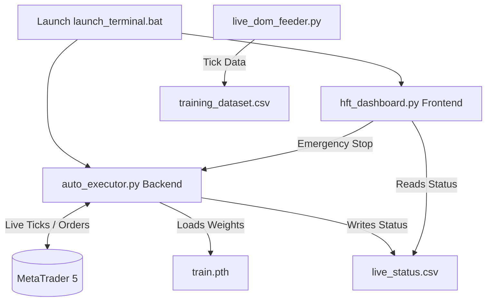

# Quant-Terminal — Technical Documentation

## 1. System Requirements & Dependencies

**Hardware & OS:**
* Windows Operating System (required for MetaTrader 5 and `.bat` execution).
* Active internet connection for live market data and broker execution.

**Software:**
* MetaTrader 5 (MT5) installed, logged into a broker account (Demo account highly recommended for testing).
* Python 3.8+ environment.

**Dependencies:**
* PyTorch (for model inference).
* Streamlit (for the dashboard UI).
* MetaTrader5 Python library (for terminal integration).
* Pandas & NumPy (for data processing).

**Installation Steps:**
1. Install Python and ensure it is added to your system PATH.
2. Install MT5 and log into your designated trading account.
3. Install required Python packages via command line:
```bash
pip install torch torchvision streamlit MetaTrader5 pandas numpy
```

---

## 2. Architecture & Workflow Diagram

The system operates via a Windows batch launcher that initiates both the execution backend and the Streamlit monitoring dashboard. 



---

## 3. Data Pipeline

* **Data Sources:** Live BTCUSD tick and market data directly streamed from MetaTrader 5 via `live_dom_feeder.py` and `auto_executor.py`.
* **Preprocessing Steps:** Incoming tick data is normalized and formatted to match the exact feature order and scaling used during the model's training phase. 
* **Features:** Price inputs, spread, and DOM (Depth of Market) metrics depending on the strategy configuration.
* **Outputs:** 
  * `training_dataset.csv` for backend model training.
  * Real-time formatted arrays fed into the PyTorch model for live inference.

---

## 4. Model / Decision Logic

* **Model Inference:** The execution engine loads a pre-trained PyTorch model (`train.pth`). It evaluates incoming, preprocessed market data continuously.
* **Decision Rules:** The model outputs AI confidence scores for BUY/SELL scenarios (Trap vs. Safe). 
* **Execution:** If the model's confidence threshold and the predefined strategy entry conditions are met, the engine triggers an order.
* **Risk Controls:** Stop-Loss (SL) and Take-Profit (TP) parameters are calculated and attached to the execution logic prior to MT5 order submission.

---

## 5. Execution Steps

1. **Verify Environment:** Ensure MT5 is open, the correct account is active, and "Algo Trading" is enabled. Ensure the BTCUSD chart is available.
2. **Launch System:** Open the project folder and double-click `launch_terminal.bat`.
3. **Start Dashboard:** The local Streamlit dashboard should automatically open in your browser at `http://localhost:8501`.
4. **Monitor Activity:** Watch the dashboard for live price, spread, AI confidence, and active execution status.
5. **Verify in MT5:** Always cross-reference open trades, SL/TP levels, and PnL directly in the MT5 Trade tab.
6. **Emergency Intervention:** Use the **Emergency Kill Switch** on the dashboard to halt new order submissions if abnormal behavior is detected. Manually close open MT5 positions if necessary.

---

## 6. Input & Output

**Expected Inputs:**
* **Market Data:** Live BTCUSD price and spread from the broker.
* **User Input:** Dashboard kill-switch activation.
* **Model Weights:** Valid `train.pth` file.

**Expected Outputs:**
* **Dashboard Display (via `live_status.csv`):** 
  * *Fields:* Live Price, Spread, AI Confidence (Traps), Active Execution (Buy/Sell/None), Live PnL.
* **Broker Execution:** Market Orders submitted to MT5 with attached Stop-Loss and Take-Profit values.

**Example Data Format (`live_status.csv`):**
```csv
timestamp,price,spread,ai_confidence,status,pnl
2026-10-27 10:05:00,64200.50,15,82.5,BUY_OPEN,12.50
```

---

## 7. Error Handling & Troubleshooting

| Issue | Likely Cause & Solution |
| :--- | :--- |
| **Dashboard does not open** | The launcher failed to start Streamlit. Check terminal output for errors. Manually navigate to `http://localhost:8501`. |
| **Dashboard values frozen** | Backend process failed or `live_status.csv` is not updating. Ensure MT5 is connected and the broker's BTCUSD symbol matches the code configuration. |
| **No trades are opening** | Entry conditions/confidence thresholds are not met. Verify `train.pth` path, check MT5 Algo Trading permissions, and review MT5 journal for broker rejections. |
| **Model fails to load** | PyTorch architecture mismatch or missing `train.pth`. Ensure training and live inference use identical feature engineering and normalization. |
| **Missing SL/TP on orders** | Broker rejected the SL/TP levels (too close to price). Check MT5 error logs. Ensure the code actively submits SL/TP during the order request. |
| **Kill Switch recovery** | Activating the Kill Switch stops new entries but may not close active trades. Manually manage open positions in MT5. Restart the `.bat` file to resume normal operations after resolving the issue. |
